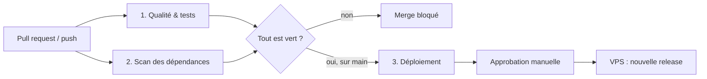

# Plan de déploiement : pipeline CI/CD

Plan **théorique et volontairement simple** pour mettre mosltrans.fr en production.
Il tient en trois mots : **tester → sécuriser → livrer**.

> Statut : la CI (étapes 1 et 2) est **réellement active** dans `.github/workflows/ci.yml`.
> Le déploiement (étape 3) est un **modèle prêt à brancher** : aucun VPS n'est
> configuré à ce jour, donc `deploy.yml` reste en déclenchement manuel.

## 1. Vue d'ensemble



Outil : **GitHub Actions**. Le dépôt est déjà sur GitHub, donc aucune infrastructure
de CI à installer ni à maintenir.

## 2. Étape 1 : qualité et tests (`ci.yml`, job `tests`)

Déclencheur : chaque pull request et chaque push sur `main`.

| Action | Pourquoi |
|---|---|
| `composer install` (avec cache) | Même dépendances que la prod, à partir de `composer.lock` |
| `lint:twig`, `lint:yaml`, `lint:container` | Détecte une erreur de syntaxe ou de configuration avant qu'elle casse le site |
| Migrations sur la base de test | Prouve que les migrations s'appliquent sur une base vide |
| `phpunit` | Exécute les tests automatiques (formulaire de contact, back-office, e-mails) |

Le job tourne sur **PHP 8.3 et 8.4** (le projet vise `>=8.2`) : on détecte une
incompatibilité de version avant la prod.

## 3. Étape 2 : scan des dépendances (`ci.yml`, job `security`)

- **`composer audit --locked`** compare chaque version figée dans `composer.lock` aux
  avis de sécurité publiés. Une faille connue fait échouer le job, donc la PR ne passe pas.
- **Exécution hebdomadaire** (cron du lundi) : une faille peut être publiée alors
  qu'on n'a touché à rien. Le scan la remonte quand même.
- **Dependabot** (`.github/dependabot.yml`) ouvre automatiquement les PR de mise à
  jour des dépendances Composer et des actions GitHub.

Pas de `npm audit` : le projet utilise AssetMapper (importmap), donc pas de
`node_modules` à scanner. C'est un choix d'architecture assumé.

> Piste d'amélioration : ajouter la détection de secrets committés (gitleaks).
> Le dépôt est public (voir `SECURITY.md`), donc un secret committé serait
> immédiatement exposé. L'action officielle exige une licence pour les
> organisations ; on peut exécuter le binaire directement.

### Constat réel au moment de l'écriture

Le premier `composer audit` sur le projet remonte **un avis de sécurité** :
`symfony/http-foundation` (CVE-2026-108082, ReDoS via l'en-tête `Cache-Control`),
corrigé en 7.4.19. Le pipeline fait donc son travail dès le premier jour : tant que
la dépendance n'est pas mise à jour (`composer update symfony/http-foundation`),
le job `security` est rouge. C'est un bon exemple concret pour la soutenance.

## 4. Étape 3 : déploiement (`deploy.yml` + `docs/deploy/deploy.sh`)

Déclencheur cible : push sur `main` **après** réussite des étapes 1 et 2.

1. **Approbation manuelle** : le job utilise l'*environment* GitHub `production`,
   configuré avec un relecteur obligatoire. Rien ne part en prod sans clic humain.
2. **Connexion SSH** au VPS avec une clé **dédiée au déploiement**, stockée dans les
   *GitHub Secrets* (jamais dans le dépôt).
3. **Script `deploy.sh` sur le serveur** :
   - clone la version exacte (le SHA du commit validé) dans `releases/<date>-<sha>` ;
   - `composer install --no-dev --optimize-autoloader` ;
   - build des assets (`tailwind:build`, `asset-map:compile`) ;
   - `doctrine:migrations:migrate` ;
   - `cache:clear`, puis **bascule atomique** du lien `current` vers la nouvelle release ;
   - recharge PHP-FPM ; conserve les 5 dernières releases.
4. **Retour arrière** : repointer `current` vers la release précédente
   (`ln -sfn releases/<précédente> current` + reload PHP-FPM). Quelques secondes,
   sans rebuild.

Arborescence sur le VPS :

```
/var/www/mosltrans/
├── releases/20261020103000-ab12cd3/   # une release par déploiement
├── shared/
│   ├── .env.local                     # secrets de prod, hors Git
│   └── var/                           # base de données et logs persistants
└── current -> releases/20261020103000-ab12cd3
```

### Secrets à créer (Settings > Environments > production)

| Secret | Contenu |
|---|---|
| `DEPLOY_SSH_KEY` | Clé privée dédiée, sans passphrase, autorisée uniquement pour l'utilisateur `deploy` |
| `DEPLOY_KNOWN_HOSTS` | Sortie de `ssh-keyscan <host>`, pour authentifier le serveur |
| `DEPLOY_HOST` / `DEPLOY_USER` | Adresse du VPS et utilisateur `deploy` |

## 5. Architecture du VPS

- **Nginx** en frontal, HTTPS via **Let's Encrypt** (certbot, renouvellement automatique).
- **PHP-FPM** pour exécuter Symfony ; la racine web pointe sur `current/public`.
- Utilisateur **`deploy` non-root**, connexion SSH **par clé uniquement**
  (mot de passe désactivé), pare-feu `ufw` (ports 22, 80, 443), `fail2ban`.
- Sauvegarde quotidienne de la base et de `shared/`, stockée hors du serveur.
- Variables de production dans `shared/.env.local`, avec un `APP_SECRET` propre à la prod.

## 6. Limites et évolutions (à dire à l'oral)

| Limite actuelle | Évolution possible |
|---|---|
| SQLite : un seul fichier, pas de montée en charge | MariaDB ou PostgreSQL en production |
| Pas d'environnement de préproduction | Un `staging` déployé à chaque merge, la prod seulement sur tag |
| Pas de supervision | Uptime Kuma (disponibilité) et centralisation des logs |
| Pas de conteneurs | Docker pour avoir des environnements identiques dev/CI/prod |
| Migrations appliquées sans filet | Sauvegarde automatique de la base juste avant `migrate` |

## 7. Garde-fous : le résumé en quatre points

1. **Aucun secret dans le code** : GitHub Secrets côté CI, `.env.local` côté serveur.
2. **Rien n'est déployé sans tests ni scan verts**, ni sans approbation humaine.
3. **Chaque déploiement est tracé** : un SHA de commit, une release datée.
4. **Retour arrière en quelques secondes**, sans reconstruire.
