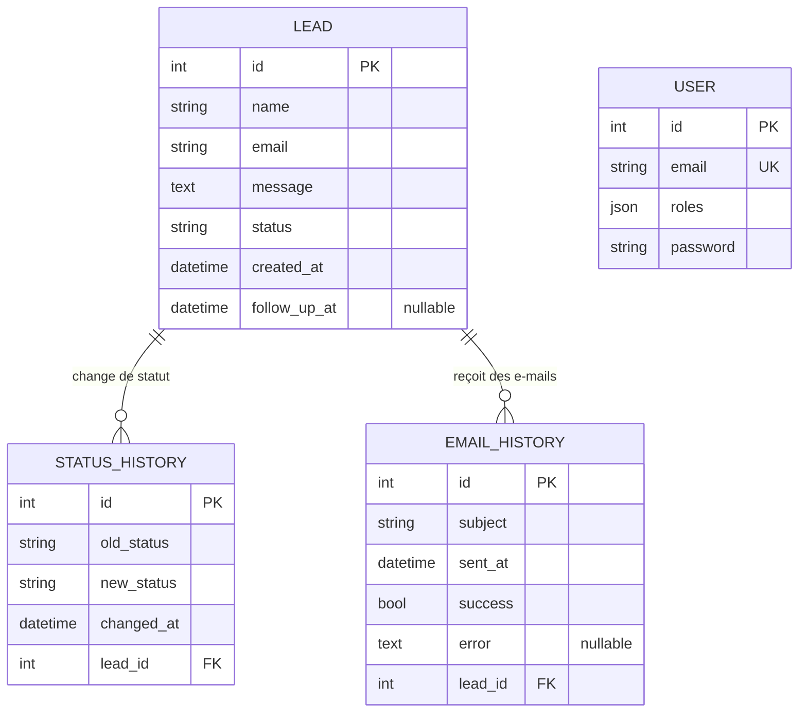
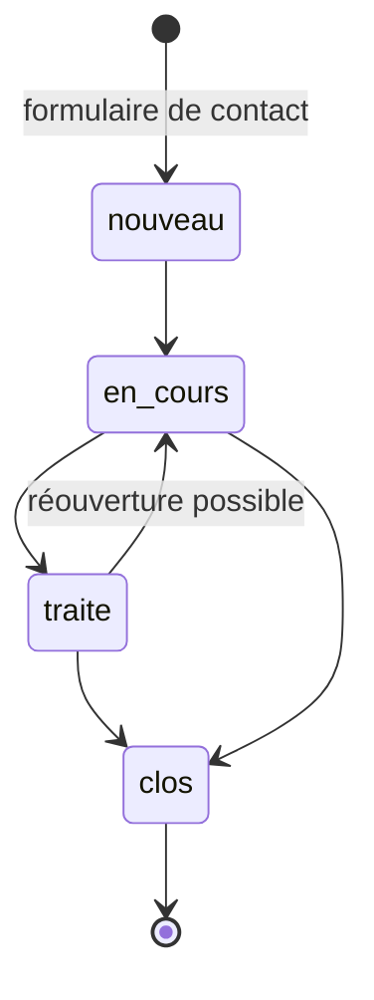

# MOSLTRANS — Modèle de données (périmètre S1 → S4)

> Référence pédagogique · 4 tables métier · SQLite · Doctrine ORM (Symfony 7.4)
> Script de création : `migrations/` · Entités : `src/Entity/`
> Installation et parcours de test : [`INSTALLATION.md`](INSTALLATION.md)

Ce document explique **pourquoi** la base est faite ainsi, pas seulement **comment**.
Pour chaque notion (entité, association, cardinalité, clé étrangère…), on part de
l'idée, on la dessine, puis on retrouve exactement la même chose dans le code et
dans le SQL. À la fin, des exercices permettent de vérifier qu'on a compris.

---

## 0. Lire ce document

| Si vous voulez… | Allez à… |
|---|---|
| comprendre l'idée générale | §2 (le modèle en une image) |
| savoir pourquoi tel choix a été fait | §1 (décisions) |
| passer du dessin au code | §5 (MCD → MPD → Doctrine) |
| voir le SQL réel | §4 (MPD) |
| vous entraîner | §9 (exercices) |

Vocabulaire minimal :

| Mot | Sens | Exemple ici |
|---|---|---|
| **Entité** | une « chose » dont on garde la trace | `Lead` (une demande de contact) |
| **Attribut** | une information sur l'entité | `email`, `message` |
| **Identifiant** | ce qui rend chaque ligne unique | `id` |
| **Association** | un lien entre deux entités | un lead *possède* des changements de statut |
| **Cardinalité** | combien de chaque côté du lien | 1 lead → 0 ou N historiques |
| **Clé étrangère (FK)** | la colonne qui matérialise le lien | `status_history.lead_id` |

---

## 1. Décisions de modélisation

| ID | Décision | Justification |
|----|----------|---------------|
| DM01 | `LEAD` = table centrale, tout le reste y est rattaché | Le cœur du projet est la gestion des demandes de contact (README §1) |
| DM02 | `USER` **séparée** de `LEAD`, sans lien entre les deux | Un visiteur qui écrit (lead) n'est pas un administrateur qui se connecte (user). Deux cycles de vie, deux tables |
| DM03 | `STATUS_HISTORY` = table dédiée (pas une colonne `ancien_statut`) | Un lead change de statut plusieurs fois : on veut **toutes** les étapes, pas seulement la dernière |
| DM04 | `EMAIL_HISTORY` = table dédiée | Même raison : plusieurs e-mails par lead, avec succès ou échec de chacun |
| DM05 | Statuts stockés en `VARCHAR`, valeurs fixées dans `Lead::STATUSES` | SQLite n'a pas de type ENUM. La liste fermée est contrôlée par le code (`Assert\Choice`) |
| DM06 | `status_history.old_status` / `new_status` recopiés en texte | L'historique doit rester lisible même si la liste des statuts évolue un jour |
| DM07 | `follow_up_at` **nullable** sur `LEAD` | Une date de relance est optionnelle : `NULL` = « pas de relance prévue » |
| DM08 | `created_at` en `DateTimeImmutable` | Une date de création ne se modifie jamais : l'objet immuable l'impose |
| DM09 | `ON DELETE CASCADE` sur les deux tables d'historique | Supprimer un lead supprime ses historiques : pas de lignes orphelines |
| DM10 | `USER.roles` stocké en JSON dans un `CLOB` | Format imposé par Symfony Security (un utilisateur peut avoir plusieurs rôles) |
| DM11 | `USER.email` unique | L'e-mail sert d'identifiant de connexion : deux comptes ne peuvent pas le partager |
| DM12 | `USER.password` = **hash**, jamais le mot de passe | Même la base volée ne doit pas révéler un mot de passe |
| DM13 | L'historique des statuts est écrit **automatiquement** (event subscriber) | Personne ne doit pouvoir « oublier » de journaliser un changement |

> **À retenir (DM02).** Quand on hésite entre « une seule grosse table » et
> « deux tables », la question à se poser est : *est-ce que ces informations vivent
> au même rythme ?* Un lead naît d'un formulaire public ; un administrateur est
> créé en ligne de commande. Ils n'ont rien à voir : on ne les mélange pas.

---

## 2. Le modèle en une image



Lecture du trait `LEAD ||--o{ STATUS_HISTORY` :

- `||` côté LEAD : un historique appartient à **exactement un** lead.
- `o{` côté STATUS_HISTORY : un lead peut avoir **zéro, un ou plusieurs** historiques.

`USER` est volontairement **seule** : aucun trait ne la relie aux autres (DM02).

---

## 3. MCD — Cardinalités Merise

### Entités — 4

| # | Entité | Identifiant | Rôle |
|---|--------|-------------|------|
| 1 | LEAD | id | une demande de contact reçue par le formulaire |
| 2 | STATUS_HISTORY | id | une ligne par changement de statut d'un lead |
| 3 | EMAIL_HISTORY | id | une ligne par e-mail envoyé (ou tenté) à un lead |
| 4 | USER | id | un compte administrateur du back-office |

### Associations simples (1-N, clé étrangère dans le MPD)

| Association | Entité gauche | Card. gauche | Card. droite | Entité droite |
|-------------|--------------|--------------|--------------|---------------|
| CHANGER_DE_STATUT | LEAD | (0,N) | (1,1) | STATUS_HISTORY |
| RECEVOIR_UN_EMAIL | LEAD | (0,N) | (1,1) | EMAIL_HISTORY |

### Comment lire une cardinalité `(min,max)`

On lit **depuis l'entité vers l'association** :

- `LEAD (0,N)` : *un lead peut avoir 0 changement de statut* (un lead qui vient
  d'arriver n'en a aucun) *et jusqu'à N*.
- `STATUS_HISTORY (1,1)` : *un changement de statut concerne obligatoirement
  1 seul lead, ni plus, ni moins*.

> **Règle pratique.** Dans une association 1-N, la clé étrangère va toujours
> **du côté du N**, c'est-à-dire du côté `(1,1)`. Ici : `lead_id` est dans
> `status_history` et `email_history`, jamais l'inverse.

### Pourquoi pas d'association N-N ?

Une association N-N (« plusieurs à plusieurs ») donnerait une table de liaison
supplémentaire. Elle n'existe pas ici : un historique n'appartient qu'à un seul
lead. Si un jour un e-mail pouvait être rattaché à *plusieurs* leads, il faudrait
la créer.

---

## 4. MPD — 4 tables

> Les types sont ceux de **SQLite** tels que Doctrine les génère
> (voir `migrations/`). `DATETIME` y est stocké en texte ISO 8601.

### LEAD

| Colonne | Type | Contraintes |
|---------|------|-------------|
| id | INTEGER | PK, AUTOINCREMENT |
| name | VARCHAR(255) | NOT NULL |
| email | VARCHAR(255) | NOT NULL |
| message | CLOB (texte long) | NOT NULL |
| status | VARCHAR(255) | NOT NULL, DEFAULT `'nouveau'` |
| created_at | DATETIME | NOT NULL |
| follow_up_at | DATETIME | nullable, DEFAULT NULL |

Valeurs autorisées pour `status` : `nouveau` · `en_cours` · `traite` · `clos`
(contrôlées par le code, voir DM05).
Règles de saisie (côté formulaire, pas côté base) : `name` et `email` non vides,
`email` valide, `message` entre **10 et 255** caractères.

### STATUS_HISTORY

| Colonne | Type | Contraintes |
|---------|------|-------------|
| id | INTEGER | PK, AUTOINCREMENT |
| old_status | VARCHAR(255) | NOT NULL |
| new_status | VARCHAR(255) | NOT NULL |
| changed_at | DATETIME | NOT NULL |
| lead_id | INTEGER | FK → LEAD, NOT NULL, ON DELETE CASCADE |

Index : `IDX_2F6A07CE55458D` sur `lead_id`.

### EMAIL_HISTORY

| Colonne | Type | Contraintes |
|---------|------|-------------|
| id | INTEGER | PK, AUTOINCREMENT |
| subject | VARCHAR(255) | NOT NULL |
| sent_at | DATETIME | NOT NULL |
| success | BOOLEAN | NOT NULL |
| error | CLOB | nullable — message d'erreur si `success = false` |
| lead_id | INTEGER | FK → LEAD, NOT NULL, ON DELETE CASCADE |

Index : `IDX_9A7A188455458D` sur `lead_id`.

### USER

| Colonne | Type | Contraintes |
|---------|------|-------------|
| id | INTEGER | PK, AUTOINCREMENT |
| email | VARCHAR(180) | NOT NULL, **UNIQUE** (`UNIQ_IDENTIFIER_EMAIL`) |
| roles | CLOB | NOT NULL — tableau JSON, ex. `["ROLE_ADMIN"]` |
| password | VARCHAR(255) | NOT NULL — hash, jamais le mot de passe en clair |

> Pourquoi `VARCHAR(180)` ici et `255` ailleurs ? C'est la valeur par défaut que
> propose Symfony pour un identifiant de connexion (limite d'index sur certains
> moteurs de base de données). Pour un simple `email` de lead, aucun index
> n'est posé : 255 suffit.

---

## 5. Du dessin au code : MCD → MPD → Doctrine

Une même idée, trois écritures. L'association **LEAD → STATUS_HISTORY** :

**① MCD (Merise)** : `LEAD (0,N) ——CHANGER_DE_STATUT—— (1,1) STATUS_HISTORY`

**② MPD (SQL)** : la clé étrangère est dans la table du côté N.

```sql
CREATE TABLE status_history (
    id          INTEGER PRIMARY KEY AUTOINCREMENT NOT NULL,
    old_status  VARCHAR(255) NOT NULL,
    new_status  VARCHAR(255) NOT NULL,
    changed_at  DATETIME NOT NULL,
    lead_id     INTEGER NOT NULL,
    CONSTRAINT FK_2F6A07CE55458D FOREIGN KEY (lead_id)
        REFERENCES lead (id) ON DELETE CASCADE
);
CREATE INDEX IDX_2F6A07CE55458D ON status_history (lead_id);
```

**③ Doctrine (PHP)** : deux attributs qui se répondent des deux côtés.

```php
// src/Entity/StatusHistory.php  — le côté « N » : il porte la clé étrangère
#[ORM\ManyToOne(inversedBy: 'statusHistories')]
#[ORM\JoinColumn(nullable: false, onDelete: 'CASCADE')]
private ?Lead $lead = null;

// src/Entity/Lead.php  — le côté « 1 » : il liste ses historiques
#[ORM\OneToMany(targetEntity: StatusHistory::class, mappedBy: 'lead',
                cascade: ['remove'], orphanRemoval: true)]
private Collection $statusHistories;
```

Table de correspondance :

| MCD | MPD (SQL) | Doctrine |
|---|---|---|
| (1,1) côté STATUS_HISTORY | `lead_id … NOT NULL` | `nullable: false` |
| (0,N) côté LEAD | aucune colonne côté `lead` | `#[ORM\OneToMany]` + `Collection` |
| suppression en cascade | `ON DELETE CASCADE` | `onDelete: 'CASCADE'` + `cascade: ['remove']` |
| « côté qui porte la FK » | colonne `lead_id` | `#[ORM\ManyToOne]` (*owning side*) |

> **Piège classique.** `OneToMany` ne crée **aucune colonne**. C'est un « confort
> de lecture » côté PHP (`$lead->getStatusHistories()`). Seule la `ManyToOne`
> crée la colonne `lead_id`. Quand on veut savoir où est la clé étrangère, on
> cherche le `ManyToOne`.

Ce qui existe en double (code **et** base), et pourquoi :

| Règle | Dans la base ? | Dans le code ? | Pourquoi les deux |
|---|---|---|---|
| `status` ∈ {nouveau, en_cours, traite, clos} | non | `Assert\Choice` | SQLite ne sait pas faire d'ENUM |
| `message` 10 à 255 caractères | non | `Assert\Length` | règle de saisie, pas d'intégrité |
| `lead_id` doit exister | **oui** (FK) | oui (relation) | la base est le dernier rempart |
| `user.email` unique | **oui** (index) | — | deux comptes identiques = faille |

---

## 6. Cycle de vie d'un lead (ce que le modèle sait raconter)

Parcours **habituel** d'un lead. Le code n'impose pas d'ordre : on peut passer de
n'importe quel statut à n'importe quel autre, et chaque passage est tracé de la même façon.



À chaque flèche, **une ligne est ajoutée dans `status_history`**, sans que le
contrôleur ait à y penser (DM13) :

```php
// src/EventSubscriber/StatusHistorySubscriber.php (extrait simplifié)
$changeSet = $unitOfWork->getEntityChangeSet($entity);
if (!isset($changeSet['status'])) { continue; }          // statut inchangé : rien à faire
[$old, $new] = $changeSet['status'];                      // Doctrine donne l'avant / l'après
$history = (new StatusHistory())
    ->setOldStatus($old)->setNewStatus($new)
    ->setChangedAt(new \DateTimeImmutable());
$entity->addStatusHistory($history);
```

Idée à retenir : Doctrine sait déjà *ce qui a changé* entre deux sauvegardes.
On s'en sert pour fabriquer l'historique, au lieu de le demander à chaque écran.

Exemple de données après deux changements :

| lead.id | lead.status |
|---|---|
| 12 | `traite` |

| status_history.id | old_status | new_status | changed_at | lead_id |
|---|---|---|---|---|
| 31 | `nouveau` | `en_cours` | 2026-09-24 09:12 | 12 |
| 32 | `en_cours` | `traite` | 2026-09-25 14:03 | 12 |

| email_history.id | subject | success | error | lead_id |
|---|---|---|---|---|
| 8 | Nous avons bien reçu votre demande | 1 | NULL | 12 |
| 9 | Suivi de votre demande | 0 | Connection could not be established… | 12 |

> `old_status` / `new_status` sont recopiés **en texte** (DM06) : l'historique reste
> vrai même si, plus tard, on renommait un statut dans la liste.

---

## 7. Requêtes SQL pour manipuler le modèle

À tester dans la base locale (`var/data.db`) avec n'importe quel client SQLite.

```sql
-- 1. Tous les leads qui attendent une relance (follow_up_at renseigné)
SELECT id, name, follow_up_at
FROM lead
WHERE follow_up_at IS NOT NULL
ORDER BY follow_up_at;

-- 2. L'historique complet d'un lead, du plus ancien au plus récent
SELECT old_status, new_status, changed_at
FROM status_history
WHERE lead_id = 12
ORDER BY changed_at;

-- 3. Combien de leads par statut ?
SELECT status, COUNT(*) AS nb
FROM lead
GROUP BY status;

-- 4. Les e-mails en échec, avec le nom du lead concerné (une jointure)
SELECT l.name, e.subject, e.sent_at, e.error
FROM email_history e
JOIN lead l ON l.id = e.lead_id
WHERE e.success = 0;

-- 5. Leads qui n'ont encore reçu aucun e-mail  (cardinalité 0 côté LEAD)
SELECT l.id, l.name
FROM lead l
LEFT JOIN email_history e ON e.lead_id = l.id
WHERE e.id IS NULL;
```

La requête 5 illustre le `0` de `(0,N)` : un lead peut exister **sans** aucune ligne
dans `email_history`. Un `JOIN` simple l'aurait fait disparaître ; il faut un
`LEFT JOIN`.

---

## 8. Ordre de création des tables

```text
-- Tables indépendantes
LEAD
USER

-- Tables qui dépendent de LEAD (portent la clé étrangère)
STATUS_HISTORY      ← lead_id
EMAIL_HISTORY       ← lead_id
```

C'est l'ordre des migrations réelles :

| Migration | Contenu |
|---|---|
| `Version20260902…` | table `lead` |
| `Version20260914…` | table `user` (authentification admin) |
| `Version20260917…` | colonne `lead.status` |
| `Version20260922…` | table `status_history` |
| `Version20260923…` | colonne `lead.follow_up_at` |
| `Version20260929…` | table `email_history` |

> **Règle.** On crée toujours la table « parent » avant la table « enfant » :
> une clé étrangère ne peut pas pointer vers une table qui n'existe pas encore.
> Pour supprimer, on fait l'inverse (d'où le `ON DELETE CASCADE`, qui évite d'avoir
> à supprimer les enfants à la main).

**Prérequis :** PHP ≥ 8.2 · extension `pdo_sqlite` · `php bin/console doctrine:migrations:migrate`

---

## 9. Exercices

1. **Lire une cardinalité.** Que signifie `(1,1)` côté STATUS_HISTORY ? Que se
   passerait-il dans la base si on retirait `NOT NULL` de `lead_id` ?
2. **Où va la clé étrangère ?** On veut ajouter une table `NOTE_INTERNE` (plusieurs
   notes par lead). Dessinez l'association, donnez les cardinalités, dites dans
   quelle table se trouve `lead_id`.
3. **ON DELETE CASCADE.** On supprime le lead n°12 depuis l'admin. Que deviennent
   ses lignes de `status_history` et `email_history` ? Et sans `CASCADE` ?
4. **Pourquoi deux colonnes ?** Pourquoi `status_history` garde-t-elle `old_status`
   **et** `new_status`, alors que `new_status` du changement n°1 est l'`old_status`
   du changement n°2 ?
5. **Nullable ou pas ?** Pour chaque colonne de `lead`, dites si elle devrait pouvoir
   être `NULL` et justifiez (indice : DM07).
6. **SQL.** Écrivez la requête qui donne, pour chaque lead, le **nombre** de changements
   de statut déjà enregistrés (indice : `LEFT JOIN` + `GROUP BY`, pour garder les
   leads à zéro).
7. **Évolution.** On veut savoir *qui* (quel `USER`) a changé le statut. Où ajouter
   la colonne ? Quelle cardinalité entre USER et STATUS_HISTORY ? Pourquoi ce choix
   casse-t-il la décision DM02, et comment la nuancer ?

<details>
<summary>Éléments de réponse</summary>

1. Un changement de statut concerne exactement un lead. Sans `NOT NULL`, on pourrait
   avoir un historique « orphelin » rattaché à aucun lead : une ligne sans sens.
2. `LEAD (0,N) — (1,1) NOTE_INTERNE` ; `lead_id` est dans `note_interne`.
3. Elles sont supprimées avec lui. Sans `CASCADE`, la base refuserait de supprimer
   le lead tant que des historiques le référencent (violation de clé étrangère).
4. Chaque ligne doit se suffire à elle-même : on lit une ligne sans avoir à
   rechercher la précédente, et la première ligne n'a pas de « précédente ».
5. Seul `follow_up_at` est facultatif : tout le reste est requis pour traiter un lead.
6. `SELECT l.id, COUNT(s.id) FROM lead l LEFT JOIN status_history s ON s.lead_id = l.id GROUP BY l.id;`
   (on compte `s.id`, pas `*`, pour que les leads sans historique donnent bien 0).
7. Colonne `user_id` (nullable : un changement automatique n'a pas d'auteur) dans
   `status_history`, `USER (0,N) — (0,1) STATUS_HISTORY`. DM02 disait « aucun lien » :
   il faudrait la réécrire en « aucun lien *métier* entre un visiteur et un compte ».

</details>

---

## 10. Hors modèle (volontairement)

Ces notions ne font **pas** partie du périmètre S1 → S4 et ne sont donc pas
modélisées ici : suivi d'envoi (`Envoi`), géocodage, page de devis enregistrée.
Elles existent dans une branche à part (`feature/site-vitrine-extras`) et pourront
faire l'objet d'un second document le jour où elles entrent dans le périmètre.

---

*Périmètre S1 → S4 · 4 entités · 2 associations 1-N · 0 association N-N · 4 tables · 6 migrations*
